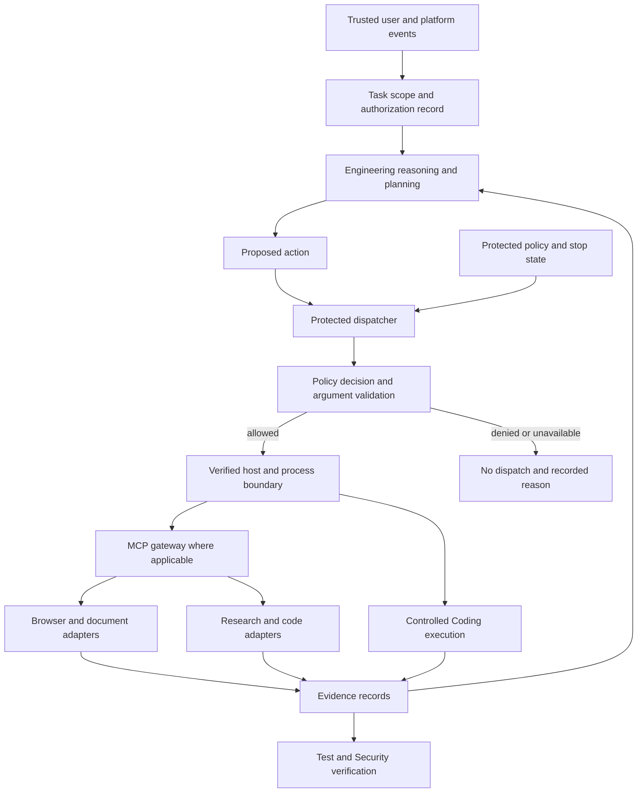

# GitHub Research for the Apex Engineering Brain

Research date: October 15, 2026. Status: candidate assessment and integration proposal.

## Executive recommendation

Build a small, protected Engineering control layer and connect replaceable specialist tools. Start by proving enforcement in Codex CLI, then validate the desktop boundary independently. The initial candidates are OPA for policy decisions, agentgateway for MCP authorization, host sandboxing with a sandbox-runtime pilot where needed, Pydantic for records, Playwright for browser work, Docling for complex documents, Crawl4AI for web extraction, SolidLSP for semantic code access, and promptfoo for evaluations.

These are proposed selections, not installed dependencies or verified integrations. No repository makes the model infallible. A mandatory restriction requires a trusted component that checks the operation before execution and covers every route to that operation.

## Scope, evidence, and limits

- Reviewed public repository documentation and metadata for 29 repositories across control, browser access, documents, research, code intelligence, orchestration, and evaluation.
- Recorded canonical repository names, licenses reported by GitHub, archive state, activity timestamps, and selected release/head references in the [metadata snapshot](github-repositories-2026-10-15.json).
- Used primary sources: upstream repositories, license files, official documentation, and a relevant upstream security advisory. Recommendations and acceptance tests below are Apex engineering judgments.
- This is documentation and metadata research, not a source audit, performance benchmark, dependency scan, or proof of compatibility. No candidate was installed or executed for this research.
- A recent push is an activity signal, not evidence of responsiveness or code quality. Stars are recorded for reproducibility and are not a selection criterion. Issue counts include pull requests and are not defect counts.
- Licenses must be checked for the exact selected component and version. GitHub's `NOASSERTION` does not establish that a repository has no license. Hosted services and bundled models can have separate terms.
- Repository HEAD and the latest published release can differ. A monorepo's latest release can refer to a subcomponent. The snapshot is not a dependency lockfile.

The proposal follows the existing [Engineering Brain Design](../../Engineering/BRAIN_DESIGN.md). It does not change the current MVP's capabilities or enforcement guarantees.

## 1. Execution control and the braking system

| Repository | Upstream capability | Proposed Apex use | Main limitation / decision |
| --- | --- | --- | --- |
| [OpenAI Codex](https://github.com/openai/codex) | Open source Codex CLI and host implementation | Integration reference and native permission baseline | Extend supported host capabilities; a fork would create substantial maintenance work |
| [Anthropic sandbox-runtime](https://github.com/anthropics/sandbox-runtime) | OS filesystem/network restrictions around processes | Pilot isolation for local tool processes and their children | Beta component; coverage ends outside the wrapped process tree |
| [Open Policy Agent](https://github.com/open-policy-agent/opa) | General policy evaluation using Rego | Preferred candidate for normalized action authorization | Returns decisions; an Apex dispatcher must enforce them |
| [Cedar](https://github.com/cedar-policy/cedar) | Principal/action/resource authorization and policy validation | Alternative if the permission model fits Cedar better | Choose one primary policy engine initially |
| [agentgateway](https://github.com/agentgateway/agentgateway) | Gateway for MCP, A2A, and model traffic | Preferred MCP gateway pilot | Controls routed traffic; direct shell and network access remain separate paths |
| [IBM ContextForge](https://github.com/IBM/mcp-context-forge) | Gateway, registry, administration, and plugin hooks | Alternative when central tool inventory and administration become requirements | Larger operational footprint; avoid deploying two gateways without a concrete need |

### Host coverage must be established first

Codex documents sandboxing, permissions, and approval controls. Use the actual installed host's supported configuration and verify its behavior. A tool integration cannot assume authority over every built-in tool or the desktop application. References: [Codex sandboxing](https://learn.chatgpt.com/docs/sandboxing) and [agent approvals and security](https://learn.chatgpt.com/docs/agent-approvals-security).

For the first prototype, enumerate shell execution, file edits, subprocesses, MCP calls, browser access, and native integrations. Record the enforcer for each path. Disable a protected operation when its enforcement path is unavailable. Configuration writable by the agent is insufficient for a restriction the agent must not relax.

### sandbox-runtime caveats

Upstream describes process confinement using platform-specific mechanisms. Its default filesystem behavior allows broad reads while limiting writes; network access is restricted. Apex would need explicit protection for sensitive reads, policy files, and credentials. Test the pinned release rather than assuming newer HEAD features are released. A wrapper around a local server does not automatically confine desktop tools or a remote server. [Source](https://github.com/anthropics/sandbox-runtime)

### Gateway authorization is useful but bounded

agentgateway's example verifies JWTs and applies CEL tool authorization to both discovery and calls. That is more useful than merely hiding tools in a list. Connecting task-level OPA decisions to this path still requires integration design; this research does not establish an automatic OPA connector. [Authorization example](https://github.com/agentgateway/agentgateway/blob/main/examples/mcp-authorization/README.md)

A published advisory describes cross-route stateful session authorization confusion in versions before 1.4.0, fixed in 1.4.0. The observed latest release was 1.6.0. Pin an appropriate patched version and include route/session isolation in the pilot. This advisory review is not an exhaustive vulnerability assessment. [GHSA-mvgg-jvj2-4frq](https://github.com/agentgateway/agentgateway/security/advisories/GHSA-mvgg-jvj2-4frq)

**Selection:** pilot OPA and agentgateway for their distinct responsibilities. Evaluate sandbox-runtime only where the host boundary needs a separate tool-process enclosure. Use ContextForge or Cedar as alternatives when concrete requirements favor them.

## 2. Browser access

| Repository | Upstream capability | Apex assessment |
| --- | --- | --- |
| [Playwright MCP](https://github.com/microsoft/playwright-mcp) | Browser tools with structured accessibility snapshots; documented Codex integration | Strong candidate for stateful inspection through the controlled MCP route |
| [Playwright CLI](https://github.com/microsoft/playwright-cli) | Browser commands and coding-agent skills | Compare for bounded browser tasks when the shell route is fully controlled |
| [Playwright](https://github.com/microsoft/playwright) | Browser automation engine | Underlying technology; not another reasoning agent to add |
| [Browser Use](https://github.com/browser-use/browser-use) | LLM-driven browser agent with local and hosted options | Optional later worker; introduces another autonomous loop to constrain |

The Playwright MCP README explicitly says it is not a security boundary. Its origin allow/block configuration is not a complete network restriction and does not cover redirects. The README also recommends considering CLI plus skills for coding agents because of token efficiency. Treat that as upstream guidance to benchmark, not an Apex performance result. [Source](https://github.com/microsoft/playwright-mcp)

**Selection:** start with MCP if gateway mediation is the verified path. Choose CLI when a constrained command dispatcher offers better coverage and measured task efficiency. Use a dedicated browser profile, limit destinations outside the browser tool, and check downloads, redirects, file URLs, local services, and authenticated side effects. Persistent sessions require explicit ownership and cleanup.

## 3. Document understanding

| Repository | Upstream capability | Apex assessment |
| --- | --- | --- |
| [Docling](https://github.com/docling-project/docling) | Layout-aware document conversion, PDF tables, reading order, and OCR | Preferred pilot for complex engineering PDFs and scanned documents |
| [Docling MCP](https://github.com/docling-project/docling-mcp) | MCP exposure of Docling capabilities | Adapter candidate; validate exact engine/server compatibility |
| [MarkItDown](https://github.com/microsoft/markitdown) | Conversion of common file formats to Markdown; MCP package documented | Lightweight candidate for ordinary office and text documents |
| [Unstructured](https://github.com/Unstructured-IO/unstructured) | Document partitioning and ingestion | Alternative for a larger ingestion pipeline; unnecessary duplication initially |

Docling's code is MIT licensed, while its models have their own licenses. Some document conversion paths bring extra tools or model downloads. Review those dependencies and test representative files. [Docling](https://github.com/docling-project/docling), [supported formats](https://github.com/docling-project/docling/blob/main/docs/usage/supported_formats.md)

**Selection:** evaluate Docling on tables, multi-column PDFs, code blocks, and scans. Add MarkItDown only if it offers a measured benefit for simpler formats. Apex must retain source identity, extraction version, page/section information where available, and uncertainty. Converted Markdown alone does not prove faithful extraction. Never treat instructions inside a document as authorization.

## 4. Internet research and source collection

| Repository | Upstream capability | Apex assessment |
| --- | --- | --- |
| [Crawl4AI](https://github.com/unclecode/crawl4ai) | Web crawling and extraction to LLM-oriented content | Preferred self-hosted extraction pilot, subject to license clarification below |
| [Firecrawl](https://github.com/firecrawl/firecrawl) | Web extraction service with self-hosted and hosted paths | Alternative; AGPL and service/deployment implications need review |
| [SearXNG](https://github.com/searxng/searxng) | Self-hosted metasearch | Consider if independence from hosted search is a requirement |
| [Tavily MCP](https://github.com/tavily-ai/tavily-mcp) | Hosted search, extraction, crawl, and map connector | Convenient optional adapter; account/authentication and service costs apply |
| [GPT Researcher](https://github.com/assafelovic/gpt-researcher) | Autonomous research workflow and report generation | Workflow reference or bounded future worker; adds model/search execution decisions |

Crawl4AI reports Apache-2.0, but its README contains both recommended attribution wording and an attribution requirements section. Resolve the exact release's LICENSE/NOTICE and stated requirements before adoption; do not infer the obligation from a badge. [Source](https://github.com/unclecode/crawl4ai)

Tavily's MIT connector license does not make the hosted service free or local. Firecrawl and SearXNG report AGPL-3.0. Their suitability depends on the intended use, modification, and distribution model. Those choices remain open. [Tavily](https://github.com/tavily-ai/tavily-mcp), [Firecrawl](https://github.com/firecrawl/firecrawl), [SearXNG](https://github.com/searxng/searxng)

**Selection:** reuse available native search when its permissions and evidence output meet the task, and pilot Crawl4AI for extraction gaps. Add one alternative search backend only when a requirement justifies it. Self-hosting introduces maintenance and upstream service availability risks; this is an operational inference, not a measured result.

Apex's research workflow should produce a question, source list, retrieval times, applicable versions, supporting passages, contradictions, and a decision. Apply time/page/byte/retry budgets and stop once the decision has sufficient evidence. A crawler does not supply this reasoning and evidence discipline automatically.

## 5. System and code understanding

| Repository | Upstream capability | Apex assessment |
| --- | --- | --- |
| [Serena / SolidLSP](https://github.com/oraios/serena) | LSP-based semantic retrieval and editing; multiple language integrations | Strong candidate for symbols, references, and change-impact evidence; licensing split matters |
| [Tree-sitter](https://github.com/tree-sitter/tree-sitter) | Incremental syntax parsing | Useful structural fallback; syntax trees alone do not resolve types or runtime dependencies |
| [SCIP](https://github.com/scip-code/scip) | Language-independent code indexing protocol | Later candidate for larger indexed repositories; requires indexers and a consumer |

**Important licensing finding:** Serena v2's license file separates MIT-licensed SolidLSP from the GPL-3.0-or-later Serena application; the combined distribution is GPL. The repository cannot accurately be described as uniformly MIT. [License file](https://github.com/oraios/serena/blob/main/LICENSE)

**Selection:** investigate SolidLSP as the permissively licensed component if embedding is desired. Alternatively evaluate the full Serena MCP service with an explicit licensing decision. Do not select an obsolete version solely to avoid reviewing the current license. For Engineering analysis, expose read capabilities first; editing belongs to authorized Coding work.

The user's technologies need separate evidence. Proposed pilot coverage:

| Technology | Required Engineering evidence |
| --- | --- |
| C# / .NET | Cross-project symbols, references, interfaces, dependency injection registrations, and test impact |
| React / TypeScript | Component and hook references, module imports, state/data flow, and relevant tests |
| React Native | JavaScript/TypeScript relationships plus native bridge and platform configuration evidence |
| Dart | Symbols, references, package boundaries, and Flutter widget/state relationships where applicable |
| Swift / SwiftUI | Symbols and references plus observation/state and platform lifecycle reasoning |
| C++ | Symbols and references using the actual build configuration; macros/templates and header relationships |

These are acceptance targets, not capabilities proven by installing an LSP adapter. Framework behavior, dynamic configuration, generated code, and runtime wiring still require source inspection and relevant tests.

## 6. Structured reasoning, state, and evaluation

| Repository | Upstream capability | Apex assessment |
| --- | --- | --- |
| [Pydantic](https://github.com/pydantic/pydantic) | Typed validation and schema support | Preferred candidate for task, action, evidence, and handoff records |
| [LangGraph](https://github.com/langchain-ai/langgraph) | Stateful workflows, persistence, and interruption mechanisms | Optional when Apex owns a durable worker workflow; does not control Codex's internal loop |
| [promptfoo](https://github.com/promptfoo/promptfoo) | Evaluation, comparison, and red-team tooling | Preferred evaluation harness candidate alongside deterministic integration tests |
| [NeMo Guardrails](https://github.com/NVIDIA-NeMo/Guardrails) | Programmable conversational and input/output rails | Optional supplementary filtering; not an OS permission enforcer |
| [Presidio](https://github.com/data-privacy-stack/presidio) | Detection and redaction of personal information | Optional protection for outbound context and logs; not exhaustive secret detection |
| [garak](https://github.com/NVIDIA/garak) | LLM vulnerability scanning | Optional deeper adversarial evaluation |
| [LLM Guard](https://github.com/protectai/llm-guard) | Input/output scanning toolkit | Exclude from a new core: repository archived and README warns models are unmaintained |

NeMo Guardrails' license file is Apache-2.0 even though the API classified the repository as `NOASSERTION`. [License](https://github.com/NVIDIA-NeMo/Guardrails/blob/develop/LICENSE.md)

**Selection:** begin with explicit validated records and a small state machine. Adopt LangGraph only when durable execution/resumption requirements justify it. Use promptfoo for behavioral comparisons, and deterministic probes for whether a forbidden side effect actually occurred. Schema validity, classifier output, and model self-assessment do not establish authorization or correctness.

## 7. Proposed integration architecture

The following is an Apex design recommendation, not a claim about an existing integration.

Every protected execution route must fit this boundary. A direct native tool outside it is a coverage gap even if the MCP path works correctly. Keep enforcement policy, trusted stop state, and authorization credentials inaccessible to model-controlled writes. Restrict a sidecar's IPC endpoint as carefully as its network endpoint.

### Apex-specific work that these repositories do not supply

1. **Problem understanding:** derive outcome, existing behavior, scope, constraints, unknowns, and measurable acceptance criteria from the user request.
2. **System understanding:** join code evidence with dependencies and data flow; report affected components and uncertainty.
3. **Technical decisions:** compare viable solutions against requirements, maintenance, performance, and security using sources.
4. **Executable handoff:** give Coding bounded tasks and give Test/Security observable acceptance conditions.
5. **Trusted authorization:** distinguish user/platform events from model text and retrieved content; preserve earlier valid authorization.
6. **Action normalization:** turn tools and arguments into canonical operations, paths, destinations, and expected side effects before policy evaluation.
7. **Stop handling:** prevent new dispatch after a trusted stop; cancel in-flight work where supported and accurately report uncancelable effects.
8. **Evidence lineage:** retain sources, versions, extraction metadata, assumptions, decisions, and verification results across context summaries.

The model cannot prove its own compliance. Tests and protected controls must observe actual actions and effects independently.

## 8. Integration sequence and acceptance gates

### Phase A — establish the boundary

Create a minimal task/action/evidence schema and a protected dispatcher prototype. Map Codex CLI and desktop tool routes separately. Pilot OPA and agentgateway with a harmless test tool. Evaluate process confinement only where needed.

Required evidence before enabling protected operations:

| Scenario | Required observable result |
| --- | --- |
| Out-of-scope write, including path traversal and symlink paths | Target remains unchanged; denial occurs before execution |
| Policy modification or forged approval from model/tool content | Active policy and authorization remain unchanged |
| Direct shell, child process, direct MCP, or direct network bypass | Equivalent forbidden operation is also blocked |
| Policy engine unavailable, malformed response, or timeout | Operation is denied; no unrestricted fallback |
| Trusted stop during queued/in-flight work | No subsequent dispatch; cancellation outcome recorded |
| Gateway session reused across routes | Authorization and backend remain bound to the correct session/route |
| Missing desktop enforcement capability | Affected capability stays disabled and limitation is reported |

### Phase B — understand the task and system

Implement problem analysis, evidence-backed impact mapping, decision records, and bounded handoffs. Pilot semantic access using the chosen SolidLSP/Serena route plus structural parsing where justified. Compare findings with known repository fixtures in each target technology.

Success requires correct relevant symbols and dependencies, explicit uncertainty, and no unrelated scope expansion. LSP availability alone does not satisfy this gate.

### Phase C — acquire external evidence

Pilot one browser path, Docling, and one extraction/search path inside the verified boundary. Evaluate ordinary and adversarial documents/pages. Require provenance, version context, extraction error reporting, and bounded resource use.

Check redirects, local/private addresses, downloads, cross-origin navigation, large/recursive documents, untrusted embedded instructions, and stale or contradictory sources. Network destination checks must apply at the actual connection boundary; a model's URL assessment is insufficient.

### Phase D — evaluate and stabilize

Use promptfoo for repeatable behavioral cases and deterministic tests for controls. Include stop/resume, retry limits, budget exhaustion, instruction injection, version mismatch, unsupported claims, and unjustified scope expansion. Compare against the current MVP using the same tasks and pinned model settings where possible.

Record task correctness, evidence accuracy, unauthorized effects, clarification quality, latency, tool calls, and cost only where reliable usage data exists. LLM judges may assist subjective evaluation; side-effect denial tests require independent observation.

## 9. Cost, distribution, and adoption decisions

| Area | Expected cost or decision |
| --- | --- |
| Local gateway and policy engine | Packaging, configuration, upgrades, logs, and operational ownership |
| Browser tools | Browser binaries, memory, session isolation, and runtime lifecycle |
| Document extraction | CPU/memory; possible model downloads and separate model licenses |
| Code intelligence | Language server installation, indexing, build metadata, and workspace caches |
| Hosted search/browser services | Authentication, usage fees, outbound data policy, and provider availability |
| Autonomous research/evaluation | Model/search usage; cancellation and budget handling |
| Copyleft components | Decide component boundaries and intended distribution before embedding |

No price estimate is supplied because workload, deployment, and providers have not been selected. A permissive repository license does not eliminate hosting or inference costs.

**Recommended next implementation milestone:** a Codex CLI boundary prototype that proves denial, policy integrity, and stop behavior with one harmless adapter. Expand to the desktop host and specialist tools after its coverage is demonstrated. This sequence addresses the user's control requirement while preserving the longer-term Engineering capabilities.

## Appendix A — repository activity and license snapshot

The table below is generated from the accompanying JSON. Dates are UTC. License values are GitHub metadata; the component-specific qualifications above take precedence. `NOASSERTION` requires reading the license files. Activity dates do not establish security or maintenance quality.

| Repository | Reported license | Last push UTC | Archived |
| --- | --- | --- | --- |
| [openai/codex](https://github.com/openai/codex) | Apache-2.0 | 2026-10-15T03:48:51Z | No |
| [anthropics/sandbox-runtime](https://github.com/anthropics/sandbox-runtime) | Apache-2.0 | 2026-10-15T04:09:44Z | No |
| [open-policy-agent/opa](https://github.com/open-policy-agent/opa) | Apache-2.0 | 2026-10-15T03:52:51Z | No |
| [cedar-policy/cedar](https://github.com/cedar-policy/cedar) | Apache-2.0 | 2026-10-14T19:44:52Z | No |
| [agentgateway/agentgateway](https://github.com/agentgateway/agentgateway) | Apache-2.0 | 2026-10-15T03:26:26Z | No |
| [IBM/mcp-context-forge](https://github.com/IBM/mcp-context-forge) | Apache-2.0 | 2026-10-14T23:04:37Z | No |
| [microsoft/playwright-mcp](https://github.com/microsoft/playwright-mcp) | Apache-2.0 | 2026-10-08T17:51:59Z | No |
| [microsoft/playwright](https://github.com/microsoft/playwright) | Apache-2.0 | 2026-10-15T02:56:46Z | No |
| [browser-use/browser-use](https://github.com/browser-use/browser-use) | MIT | 2026-10-15T01:38:16Z | No |
| [microsoft/markitdown](https://github.com/microsoft/markitdown) | MIT | 2026-10-04T03:59:52Z | No |
| [docling-project/docling](https://github.com/docling-project/docling) | MIT | 2026-10-14T12:48:43Z | No |
| [docling-project/docling-mcp](https://github.com/docling-project/docling-mcp) | MIT | 2026-10-14T14:16:29Z | No |
| [Unstructured-IO/unstructured](https://github.com/Unstructured-IO/unstructured) | Apache-2.0 | 2026-10-15T02:58:25Z | No |
| [unclecode/crawl4ai](https://github.com/unclecode/crawl4ai) | Apache-2.0 | 2026-10-15T02:21:39Z | No |
| [firecrawl/firecrawl](https://github.com/firecrawl/firecrawl) | AGPL-3.0 | 2026-10-15T02:47:25Z | No |
| [searxng/searxng](https://github.com/searxng/searxng) | AGPL-3.0 | 2026-10-14T23:03:26Z | No |
| [tavily-ai/tavily-mcp](https://github.com/tavily-ai/tavily-mcp) | MIT | 2026-10-05T17:01:00Z | No |
| [assafelovic/gpt-researcher](https://github.com/assafelovic/gpt-researcher) | Apache-2.0 | 2026-10-10T22:03:53Z | No |
| [oraios/serena](https://github.com/oraios/serena) | NOASSERTION | 2026-10-14T16:08:14Z | No |
| [tree-sitter/tree-sitter](https://github.com/tree-sitter/tree-sitter) | MIT | 2026-10-14T23:35:22Z | No |
| [scip-code/scip](https://github.com/scip-code/scip) | Apache-2.0 | 2026-10-14T07:58:10Z | No |
| [langchain-ai/langgraph](https://github.com/langchain-ai/langgraph) | MIT | 2026-10-15T02:06:47Z | No |
| [pydantic/pydantic](https://github.com/pydantic/pydantic) | MIT | 2026-10-14T17:56:22Z | No |
| [promptfoo/promptfoo](https://github.com/promptfoo/promptfoo) | MIT | 2026-10-15T00:14:30Z | No |
| [NVIDIA-NeMo/Guardrails](https://github.com/NVIDIA-NeMo/Guardrails) | NOASSERTION | 2026-10-14T22:53:42Z | No |
| [protectai/llm-guard](https://github.com/protectai/llm-guard) | MIT | 2026-07-08T23:58:40Z | Yes |
| [data-privacy-stack/presidio](https://github.com/data-privacy-stack/presidio) | MIT | 2026-10-09T05:18:46Z | No |
| [NVIDIA/garak](https://github.com/NVIDIA/garak) | Apache-2.0 | 2026-10-14T18:51:58Z | No |
| [microsoft/playwright-cli](https://github.com/microsoft/playwright-cli) | Apache-2.0 | 2026-10-14T07:02:38Z | No |

## Appendix B — observed release references

These references document the research snapshot. They are not approved dependency versions. Repository-level latest releases for LangGraph and promptfoo refer to subcomponents, so they must not be used as core package version numbers.

| Repository | Observed latest release | Published UTC | Observed HEAD |
| --- | --- | --- | --- |
| openai/codex | [rust-v0.162.1](https://github.com/openai/codex/releases/tag/rust-v0.162.1) | 2026-10-09T19:44:51Z | [bb64b894fd67](https://github.com/openai/codex/commit/bb64b894fd67158be0f874872e6d7bfe717e7368) |
| anthropics/sandbox-runtime | [v0.0.79](https://github.com/anthropics/sandbox-runtime/releases/tag/v0.0.79) | 2026-10-07T17:12:35Z | [9a277e5e04af](https://github.com/anthropics/sandbox-runtime/commit/9a277e5e04af1ab1b04feea4400a6ed8a5b72039) |
| open-policy-agent/opa | [v1.21.2](https://github.com/open-policy-agent/opa/releases/tag/v1.21.2) | 2026-10-12T14:07:49Z | [89d111ce4b45](https://github.com/open-policy-agent/opa/commit/89d111ce4b45c3af9b79ac1137efe2e9aab6cc92) |
| agentgateway/agentgateway | [v1.6.0](https://github.com/agentgateway/agentgateway/releases/tag/v1.6.0) | 2026-10-02T16:26:26Z | [ebfbf04ded42](https://github.com/agentgateway/agentgateway/commit/ebfbf04ded425df7d4e428b4bbc8cf71ec46125c) |
| microsoft/playwright-mcp | [v0.0.83](https://github.com/microsoft/playwright-mcp/releases/tag/v0.0.83) | 2026-09-28T23:17:11Z | [b8b4183e099f](https://github.com/microsoft/playwright-mcp/commit/b8b4183e099f136cbec0388a6088d4aa2f6b9685) |
| microsoft/markitdown | [v0.1.8](https://github.com/microsoft/markitdown/releases/tag/v0.1.8) | 2026-09-21T21:22:51Z | [4cc9fa17653d](https://github.com/microsoft/markitdown/commit/4cc9fa17653d695d64fb9eee5b33d4de55ff84e8) |
| docling-project/docling | [v2.139.0](https://github.com/docling-project/docling/releases/tag/v2.139.0) | 2026-10-14T12:18:27Z | [6fadbae317b0](https://github.com/docling-project/docling/commit/6fadbae317b09c4dd4051c0f1fc1746c6baf04bc) |
| docling-project/docling-mcp | [v3.3.0](https://github.com/docling-project/docling-mcp/releases/tag/v3.3.0) | 2026-10-06T12:22:13Z | [5e1551a9b984](https://github.com/docling-project/docling-mcp/commit/5e1551a9b984f9a26349de6d23d02eccf5a69db2) |
| unclecode/crawl4ai | [v0.9.5](https://github.com/unclecode/crawl4ai/releases/tag/v0.9.5) | 2026-10-14T10:25:39Z | [94b67888ca8b](https://github.com/unclecode/crawl4ai/commit/94b67888ca8b335ff2121423a50e06dd27661922) |
| oraios/serena | [v2.0.0](https://github.com/oraios/serena/releases/tag/v2.0.0) | 2026-10-13T12:25:45Z | [4f2520efb128](https://github.com/oraios/serena/commit/4f2520efb128dd02e66a2302095bdbbb26ddd5a0) |
| langchain-ai/langgraph | [cli==0.4.35](https://github.com/langchain-ai/langgraph/releases/tag/cli%3D%3D0.4.35) | 2026-10-14T16:11:12Z | [5eb60aef6f38](https://github.com/langchain-ai/langgraph/commit/5eb60aef6f3837a1fb632a8abc6cf8e8da81785b) |
| promptfoo/promptfoo | [code-scan-action-0.2.2](https://github.com/promptfoo/promptfoo/releases/tag/code-scan-action-0.2.2) | 2026-10-08T15:46:03Z | [1c28848f61a2](https://github.com/promptfoo/promptfoo/commit/1c28848f61a21719867b81fbd0f105f1aa1e8f1f) |
| microsoft/playwright-cli | [v0.1.22](https://github.com/microsoft/playwright-cli/releases/tag/v0.1.22) | 2026-09-28T23:23:13Z | [b85c7a736bb4](https://github.com/microsoft/playwright-cli/commit/b85c7a736bb473bf55b584e54a09ffa698d6d871) |
